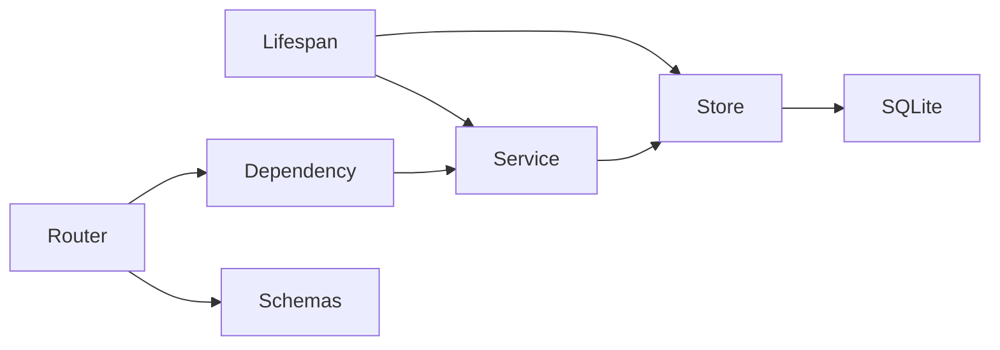

# Requirements

### Goal
Restructure the existing FastAPI application into the agreed responsibility-based layout in one branch. The numbered delivery steps are intended as independently working, single-commit chunks.

### Compatibility and scope
- Preserve the HTTP routes, payloads, validation, error responses, request IDs, logging behavior, synchronous local and OpenAI generation, idempotency, SQLite data, settings, and startup/shutdown behavior.
- Keep retrieval unimplemented; do not add provider integrations, asynchronous processing, database migrations, or new features. Preserve the existing OpenAI integration.
- Update affected tests, documentation, docstrings, and comments with each relevant change. No compatibility aliases for the old internal module paths are required.

# Technical Design

### Current implementation
`app/api/main.py` owns application setup, routes, dependencies, and some public models. `app/services/question_workflow.py` owns submission orchestration; `app/models/questions.py` defines internal DTOs and `app/models/generation.py` contains active generation adapters. `app/api/schemas.py` exposes a polling wrapper that reuses the internal result model.

### Design and contracts
- The lifespan creates a `SQLiteQuestionJobStore` and injects it into `QuestionWorkflow`; the lifespan closes the store on shutdown, including when service setup fails after store creation. FastAPI's dependency returns the shared workflow from application state; test overrides target that same dependency.
- The store owns the existing SQLite schema, locking, WAL, timeout, readiness query, idempotency, and duplicate/missing-job behavior. Legacy JSON rows remain readable and the existing schema upgrades remain intact.
- `QuestionWorkflow.submit_question` generates the job ID and preserves the existing processing, idempotency, and terminal persistence workflow; the HTTP layer retains its generic error handling. The workflow remains independent of FastAPI.
- Internal job and result models remain separate from public Pydantic schemas. Routes explicitly map results and jobs to public response models, retaining field shapes, validation behavior, and OpenAPI contracts.

### Target file structure
- `app/main.py`: application, lifespan, middleware registration, and exception handlers.
- `app/routers/health.py`, `app/routers/questions.py`: HTTP endpoints.
- `app/dependencies/questions.py`: service lookup and wiring support.
- `app/services/question_workflow.py`, `app/services/models.py`: orchestration and internal DTOs.
- `app/stores/questions.py`: SQLite persistence.
- `app/schemas/questions.py`, `app/schemas/errors.py`: public request and response models.
- `app/config/settings.py`, `app/config/logging.py`: existing configuration and logging.
- `app/middleware.py`: existing request middleware; `app/llm/` contains the existing generation adapters and `app/retrieval/` remains a future adapter package. Retain `app/tools/` and remove `app/models/` after relocating its contents.
- Update `Dockerfile`, `README.md`, `docs/architecture.md`, `docs/other-apis-sequence.md`, relevant tests, and any other stale references found during implementation.

### Flow

### Risks
Preserve SQLite locking and serialized field names across the extraction; do not silently change existing data. Moving modules changes logger names and test override identities, so adjust tests while retaining log contents, headers, error handling, and privacy guarantees.

# Testing

### Validation
- Run the existing unit and integration suites and Ruff checks at each relevant commit; keep each commit runnable with its matching startup command.
- Verify submit/poll payloads, whitespace and length validation, unknown jobs, missing or malformed results, generic 500 errors, readiness, request IDs, and structured logging.
- Cover store creation, duplicate and missing IDs, timeout, WAL, readiness after close, lifecycle cleanup, and persistence across reopen. Include a pre-refactor-format SQLite fixture to check backward compatibility.
- Compare generated OpenAPI request, response, and error schemas and verify the updated Uvicorn entry point and Docker configuration.

# Delivery Steps

### ✓ Step 1: 1. Move configuration and logging
Settings and logging live under `app/config/` without changing their behavior.

- Move `app/core/config.py` and `app/core/logging.py` to `app/config/settings.py` and `app/config/logging.py`.
- Update application and `tests/unit/test_config.py` imports, affected docstrings, and current configuration references in documentation.
- Run configuration and API tests and lint checks to confirm settings, logging, and startup still work.

### ✓ Step 2: 2. Extract and inject the SQLite store
The question service delegates persistence to a lifespan-owned SQLite store.

- Move connection management, locking, SQL, WAL, timeout, job serialization, and readiness to `app/stores/questions.py`.
- Inject the store into `QuestionService`; update the existing lifespan to create it and close it reliably, including partial startup failure.
- Adapt service and integration fixtures to inject and close test stores, and retain existing failure cases.
- Add store and lifecycle coverage, including reopening pre-refactor-format job data; update affected architecture notes, comments, and tests.

### ✓ Step 3: 3. Move question submission orchestration into the service
The service owns the synchronous processing and terminal persistence workflow while the endpoint remains behavior-compatible.

- Add `QuestionWorkflow.submit_question` and move ID generation and orchestration from the existing endpoint into it.
- Keep local and OpenAI generation and HTTP-specific missing-result handling unchanged.
- Update service tests and API failure doubles to exercise successful, incomplete, and failing workflows.
- Update workflow descriptions and the readiness sequence diagram to reflect the actual `SELECT request_id FROM question_jobs LIMIT 1` check.

### ✓ Step 4: 4. Separate internal models from public schemas
Public HTTP models are defined independently of internal job and result models.

- Move internal DTOs to `app/services/models.py` and update service and store imports without changing stored JSON.
- Define question, result, job, and error schemas under `app/schemas/`; explicitly map service results to public models in the existing endpoints.
- Preserve response validation, field shapes, and OpenAPI contracts; update tests and affected model documentation.
- Check existing persisted jobs, malformed server results, validation errors, and API responses.

### ✓ Step 5: 5. Extract routers and switch the entry point
The application starts from `app/main.py` with routers, dependency wiring, and adapter packages in their agreed locations.

- Extract health and question routes into `app/routers/` and service lookup into `app/dependencies/questions.py`; move middleware and application setup to the target modules.
- Move the existing generation interfaces and adapters from `app/models/` to `app/llm/`, retaining `app/retrieval/` and `app/tools/` as placeholders.
- Update `Dockerfile` and README Uvicorn commands in the same commit, along with architecture documentation, sequence diagrams, comments, test imports, dependency overrides, and logger assertions.
- Run the full test suite and lint checks, compare OpenAPI, and smoke-test the new application entry point.