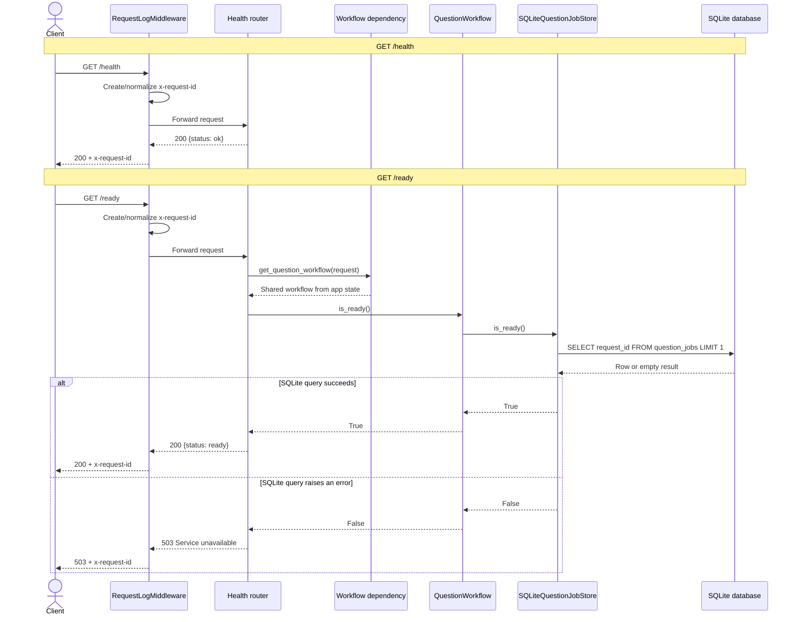

# Other API sequence diagrams

These are the health routes in `app/routers/health.py`: `/health` and
`/ready`. Both requests pass through `app/middleware.py`; `/ready` obtains the
shared workflow through `app/dependencies/questions.py`.

## Text preview

```text
Client          Middleware       FastAPI route       Workflow       SQLite store       SQLite database
  |                |                 |                 |                |                |
  | GET /health    |                 |                 |                |                |
  |--------------->|                 |                 |                |                |
  |                | add request ID |                 |                |                |
  |                |---------------->|                 |                |                |
  |                |                 | return {ok}     |                |                |
  |                |<----------------| 200 response    |                |                |
  |<---------------| response + x-request-id           |                |                |
  |                |                 |                 |                |                |
  | GET /ready     |                 |                 |                |                |
  |--------------->|---------------->|                 |                |                |
  |                |                 | is_ready()      |                |                |
  |                |                 |---------------->|                |                |
  |                |                 |                 | is_ready()     |                |
  |                |                 |                 |--------------->|                |
  |                |                 |                 |                | SELECT request_id FROM question_jobs LIMIT 1
  |                |                 |                 |                |--------------->|
  |                |                 |                 |                |<---------------|
  |                |                 |<----------------| True/False      |                |
  |                |                 |                 |                |                |
  |<---------------|<----------------| 200 ready or 503 unavailable      |                |
```


