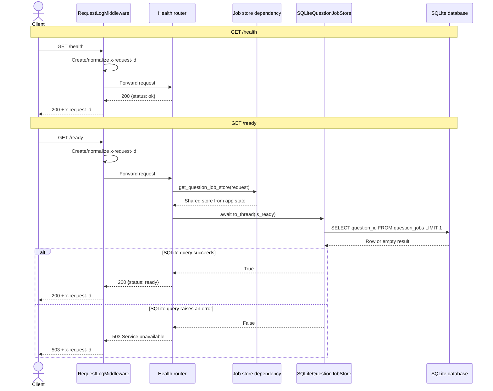
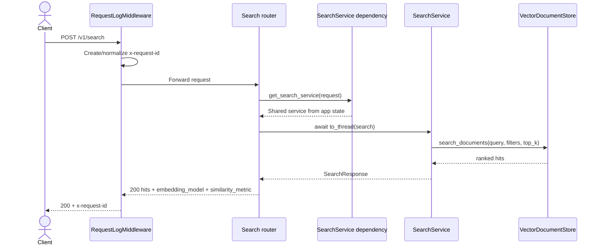

# Other API sequence diagrams

These are the health routes in `app/routers/health.py`: `/health` and
`/ready`. Both requests pass through `app/middleware.py`. `/ready` obtains the
shared question-job store through `app/dependencies/question_jobs.py`.

## Text preview

```text
Client          Middleware       FastAPI route       SQLite store       SQLite database
  |                |                 |                 |                |
  | GET /health    |                 |                 |                |
  |--------------->|                 |                 |                |
  |                | add request ID |                 |                |
  |                |---------------->|                 |                |
  |                |                 | {"status":"ok"} |                |
  |                |<----------------| 200 response    |                |
  |<---------------| response + x-request-id           |                |
  |                |                 |                 |                |
  | GET /ready     |                 |                 |                |
  |--------------->|---------------->|                 |                |
  |                |                 | await to_thread(is_ready) |      |
  |                |                 |---------------->|                |
  |                |                 |                 | SELECT question_id FROM question_jobs LIMIT 1
  |                |                 |                 |--------------->|
  |                |                 |                 |<---------------|
  |                |                 |<----------------| True/False      |
  |                |                 |                 |                |
  |<---------------|<----------------| 200 ready or 503 unavailable      |
```



## POST /v1/search

Retrieval-only search in `app/routers/search.py`. The route obtains
`SearchService` through `app/dependencies/search.py` and offloads the store
lookup with `asyncio.to_thread`.

```text
Client          Middleware       Search route       SearchService       Vector store
  |                |                 |                 |                |
  | POST /v1/search|                 |                 |                |
  |--------------->|                 |                 |                |
  |                | add request ID |                 |                |
  |                |---------------->|                 |                |
  |                |                 | await to_thread(search) |        |
  |                |                 |---------------->|                |
  |                |                 |                 | embed query + top-k
  |                |                 |                 |--------------->|
  |                |                 |                 |<---------------|
  |                |                 |<----------------| SearchResponse |
  |                |<----------------| 200 hits        |                |
  |<---------------| response + x-request-id           |                |
```


