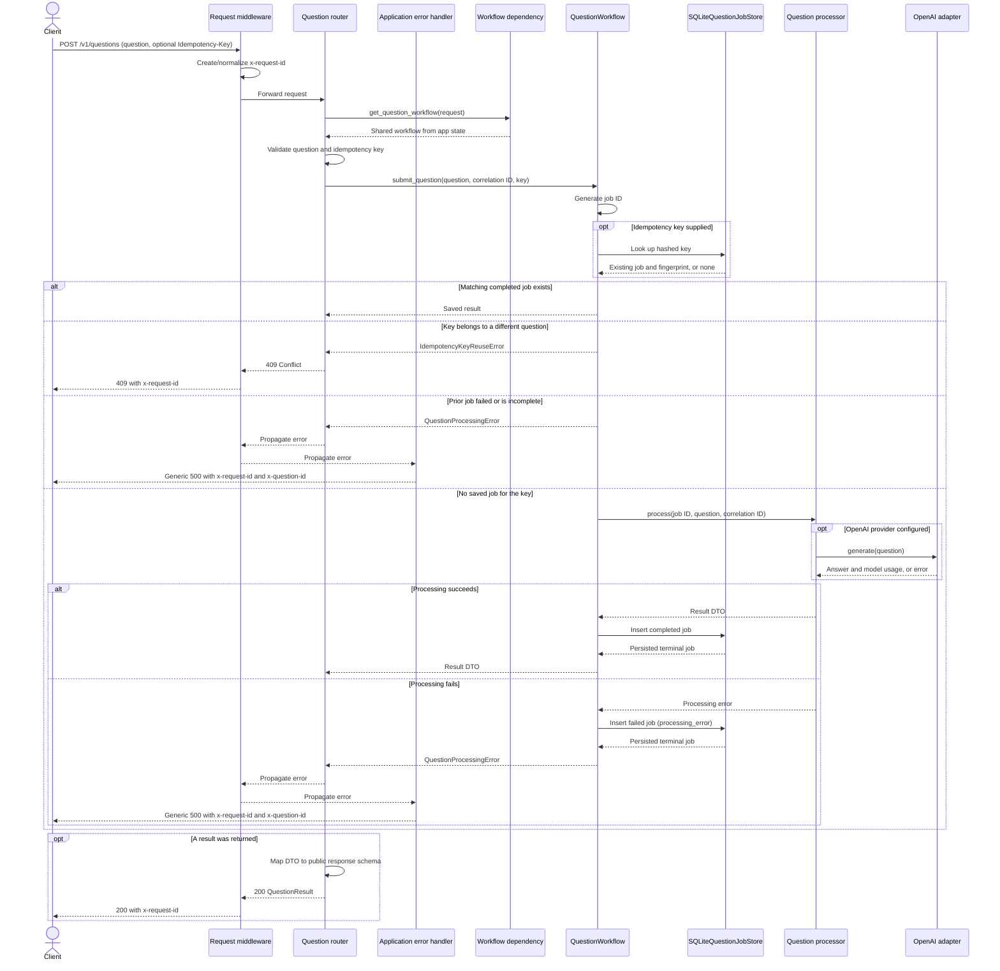
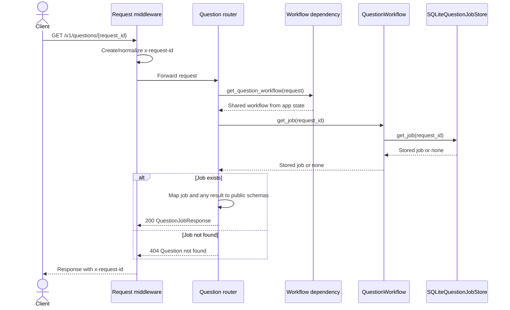

# Question API sequence diagrams

The routes in `app/routers/questions.py` use the shared `QuestionWorkflow`
from `app/dependencies/questions.py`. `app/middleware.py` supplies the HTTP
correlation ID; the workflow generates a separate question job ID. Public
request and response models live in `app/schemas/`, separate from service DTOs.

## Submit a question

`POST /v1/questions` processes the question synchronously and returns the
completed result. The request body contains `question`; whitespace is stripped
and the resulting value must contain 1–4,000 characters. An optional
`Idempotency-Key` must contain 1–255 characters and cannot be blank.

The configured local processor returns a placeholder; the OpenAI processor
uses the Responses API. Neither performs retrieval: citations are empty and
retrieval counts are zero. No pending state or in-flight idempotency claim is
stored by this workflow. Simultaneous requests with the same new key may both
process; the first saved terminal job wins, and a different question for that
key produces a conflict. A saved failed or incomplete job returns a generic
500 on retry rather than being processed again. The diagram shows the usual
non-racing path; in a race, insertion can return the other request's job or a
key-conflict error instead.

Invalid request data or keys return 422. Other unexpected errors, including
failure to persist a failed job or an invalid server result, return a generic
500; `x-question-id` is included for `QuestionProcessingError` only. The
`x-request-id` response header is the HTTP correlation ID, not the job ID.

## Retrieve a question job

The job response contains `request_id`, `status`, `result`, and
`error_category`. A completed job has a result; a failed job has the safe
`processing_error` category. Legacy pending jobs can still be read, although
the current submission workflow persists only terminal jobs. Archived jobs are
not returned by this endpoint.