# Question API sequence diagrams

The routes in `app/routers/questions.py` use the shared `QuestionWorkflow`
from `app/dependencies/questions.py`. `app/middleware.py` supplies the HTTP
request ID; the workflow generates a separate question ID. Public request and
response models live in `app/schemas/`, separate from service DTOs.

## Submit a question

`POST /v1/questions` processes the question synchronously and returns the
completed result. The request body contains `question`; whitespace is stripped
and the resulting value must contain 1–4,000 characters. An optional
`Idempotency-Key` must contain 1–255 characters and cannot be blank.

```mermaid
sequenceDiagram
    actor Client
    participant MW as Request middleware
    participant API as Question router
    participant Err as Application error handler
    participant Dep as Workflow dependency
    participant WF as QuestionWorkflow
    participant Store as SQLiteQuestionJobStore
    participant Processor as Question processor
    participant LLM as OpenAI adapter

    Client->>MW: POST /v1/questions (question, optional Idempotency-Key)
    MW->>MW: Create/normalize x-request-id
    MW->>API: Forward request

    alt Request body or header fails FastAPI/Pydantic validation
        API-->>MW: Propagate RequestValidationError
        MW-->>Err: Propagate RequestValidationError
        Err-->>Client: 422 with detail and x-request-id
    else Blank Idempotency-Key after strip
        API-->>MW: 422 Idempotency-Key must not be blank
        MW-->>Client: 422 with x-request-id
    else Request is structurally valid
        API->>Dep: get_question_workflow(request)
        Dep-->>API: Shared workflow from app state
        API->>WF: submit_question(question, request ID, key)
        WF->>WF: Generate question ID

        opt Idempotency key supplied
            alt Key blank or longer than 255 after workflow strip
                WF-->>API: InvalidIdempotencyKeyError
                API-->>MW: 422 Idempotency-Key must contain 1 to 255 characters
                MW-->>Client: 422 with x-request-id
            else Key is within length limits
                WF->>Store: Look up hashed key
                alt Stored idempotency row is incomplete
                    Store-->>WF: IncompleteIdempotencyRecordError
                    WF-->>API: IncompleteIdempotencyRecordError
                    API-->>MW: 500 Idempotency-Key record is incomplete
                    MW-->>Client: 500 with x-request-id (no x-question-id)
                else Existing job found
                    Store-->>WF: Existing job and fingerprint
                    alt Fingerprint belongs to a different question
                        WF-->>API: IdempotencyKeyReuseError
                        API-->>MW: 409 Conflict
                        MW-->>Client: 409 with x-request-id
                    else Matching completed job
                        WF-->>API: Saved result
                    else Matching failed or incomplete job
                        WF-->>API: QuestionProcessingError
                        API-->>MW: Propagate error
                        MW-->>Err: Propagate error
                        Err-->>Client: Generic 500 with x-request-id and x-question-id
                    end
                else No row for the key
                    Store-->>WF: None
                end
            end
        end

        alt Workflow already returned a saved completed result
            API->>API: Map DTO to public response schema
            API-->>MW: 200 QuestionResultResponse
            MW-->>Client: 200 with x-request-id
        else Workflow already returned an HTTP error above
            Note over Client,LLM: Request finished in an earlier branch
        else No reusable terminal job
            WF->>Processor: process(question ID, question, request ID)
            opt OpenAI provider configured
                Processor->>LLM: generate(question)
                LLM-->>Processor: Answer and model usage, or error
            end

            alt Processing succeeds
                Processor-->>WF: Result DTO
                WF->>Store: Insert completed job
                alt Insert persists this request's completed job
                    Store-->>WF: Persisted terminal job
                    WF-->>API: Result DTO
                    API->>API: Map DTO to public response schema
                    API-->>MW: 200 QuestionResultResponse
                    MW-->>Client: 200 with x-request-id
                else Race returns another request's completed job
                    Store-->>WF: Other request's completed job
                    WF-->>API: Other request's saved result
                    API->>API: Map DTO to public response schema
                    API-->>MW: 200 QuestionResultResponse
                    MW-->>Client: 200 with x-request-id
                else Race returns another request's failed or incomplete job
                    Store-->>WF: Other request's failed or incomplete job
                    WF-->>API: QuestionProcessingError
                    API-->>MW: Propagate error
                    MW-->>Err: Propagate error
                    Err-->>Client: Generic 500 with x-request-id and x-question-id
                else Insert hits a different-question key conflict
                    Store-->>WF: IdempotencyKeyReuseError
                    WF-->>API: IdempotencyKeyReuseError
                    API-->>MW: 409 Conflict
                    MW-->>Client: 409 with x-request-id
                else Insert finds an incomplete idempotency row
                    Store-->>WF: IncompleteIdempotencyRecordError
                    WF-->>API: IncompleteIdempotencyRecordError
                    API-->>MW: 500 Idempotency-Key record is incomplete
                    MW-->>Client: 500 with x-request-id (no x-question-id)
                else Insert fails for another reason
                    Store-->>WF: Persistence error
                    WF-->>API: QuestionStatePersistenceError
                    API-->>MW: Propagate error
                    MW-->>Err: Propagate error
                    Err-->>Client: Generic 500 with x-request-id (no x-question-id)
                end
            else Processing fails
                Processor-->>WF: Processing error
                WF->>Store: Insert failed job (processing_error)
                alt Insert persists this request's failed job
                    Store-->>WF: Persisted terminal job
                    WF-->>API: QuestionProcessingError
                    API-->>MW: Propagate error
                    MW-->>Err: Propagate error
                    Err-->>Client: Generic 500 with x-request-id and x-question-id
                else Race returns another request's completed job
                    Store-->>WF: Other request's completed job
                    WF-->>API: Other request's saved result
                    API->>API: Map DTO to public response schema
                    API-->>MW: 200 QuestionResultResponse
                    MW-->>Client: 200 with x-request-id
                else Race returns another request's failed or incomplete job
                    Store-->>WF: Other request's failed or incomplete job
                    WF-->>API: QuestionProcessingError
                    API-->>MW: Propagate error
                    MW-->>Err: Propagate error
                    Err-->>Client: Generic 500 with x-request-id and x-question-id
                else Insert hits a different-question key conflict
                    Store-->>WF: IdempotencyKeyReuseError
                    WF-->>API: IdempotencyKeyReuseError
                    API-->>MW: 409 Conflict
                    MW-->>Client: 409 with x-request-id
                else Insert finds an incomplete idempotency row
                    Store-->>WF: IncompleteIdempotencyRecordError
                    WF-->>API: IncompleteIdempotencyRecordError
                    API-->>MW: 500 Idempotency-Key record is incomplete
                    MW-->>Client: 500 with x-request-id (no x-question-id)
                else Insert fails for another reason
                    Store-->>WF: Persistence error
                    WF-->>API: QuestionStatePersistenceError
                    API-->>MW: Propagate error
                    MW-->>Err: Propagate error
                    Err-->>Client: Generic 500 with x-request-id (no x-question-id)
                end
            end
        end
    end
```



The configured local processor returns a placeholder; the OpenAI processor
uses the Responses API. Neither performs retrieval: citations are empty and
retrieval counts are zero. No pending state or in-flight idempotency claim is
stored by this workflow. Simultaneous requests with the same new key may both
process; the first saved terminal job wins. A race can return the other
request's completed result as `200`, raise `409` when the fingerprints differ,
surface an incomplete-key `500`, or replay a prior failure as a generic `500`
with `x-question-id`.

Response summary:

| Outcome | Status | `detail` / body | `x-question-id` |
| --- | --- | --- | --- |
| Completed answer | `200` | `QuestionResultResponse` | no |
| Invalid body or blank/oversized key | `422` | validation or key message | no |
| Idempotency key reused for a different question | `409` | conflict message | no |
| Incomplete idempotency row | `500` | `Idempotency-Key record is incomplete` | no |
| Processing failure after the failed job is saved | `500` | `Internal server error` | yes |
| Persistence failure or other unexpected server error | `500` | `Internal server error` | no |

`x-request-id` is returned on every response. `x-question-id` is set only for
`QuestionProcessingError`.

## Retrieve a question job

```mermaid
sequenceDiagram
    actor Client
    participant MW as Request middleware
    participant API as Question router
    participant Dep as Workflow dependency
    participant WF as QuestionWorkflow
    participant Store as SQLiteQuestionJobStore

    Client->>MW: GET /v1/questions/{question_id}
    MW->>MW: Create/normalize x-request-id
    MW->>API: Forward request
    API->>Dep: get_question_workflow(request)
    Dep-->>API: Shared workflow from app state
    API->>WF: get_job(question_id)
    WF->>Store: get_job(question_id)
    Store-->>WF: Stored job or none
    WF-->>API: Stored job or none
    alt Job exists
        API->>API: Map job and any result to public schemas
        API-->>MW: 200 QuestionJobResponse
        Note over API,MW: completed includes result; failed includes error_category=processing_error; legacy pending has neither
    else Job not found
        API-->>MW: 404 Question not found
    end
    MW-->>Client: Response with x-request-id
```

The job response contains `question_id`, `status`, `result`, and
`error_category`. A completed job has a result; a failed job has the safe
`processing_error` category. Legacy pending jobs can still be read, although
the current submission workflow persists only terminal jobs. Archived jobs are
not returned by this endpoint.
